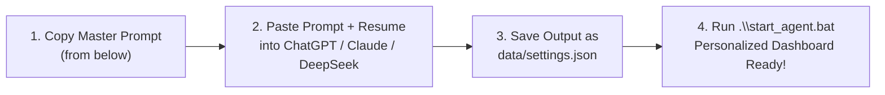

# 🤖 1-Click AI Setup Guide: Generate Your `settings.json`

Want to personalize **GetMeHired** to your exact background in 60 seconds without writing code or editing JSON manually? 

You can use **any AI model** (ChatGPT, Claude, Gemini, DeepSeek, etc.) to read your resume and generate your tailored `data/settings.json` file automatically.

---

## ⚡ The 3-Step Workflow



---

## 📋 The Master AI Prompt (Copy & Paste)

Copy the prompt block below, paste it into ChatGPT, Claude, Gemini, or DeepSeek, and append your resume text (or attach your resume PDF):

````markdown
You are a senior technical career advisor and JSON generator for "GetMeHired", an autonomous job agent.

Read my resume below and generate a complete, valid JSON configuration for my `data/settings.json` file based on the template schema provided.

### Instructions:
1. Extract my full name, headline, contact info, education, core technical skills (15-20 top keywords), years of experience, and a concise summary.
2. Select 4-6 target roles matching my background (e.g., "Full Stack Engineer", "Backend Engineer", "AI/ML Engineer", "DevOps Engineer").
3. Determine target locations (include key tech hubs in my country plus "Remote").
4. Formulate an aggressive, professional `agent_directives` prompt that tells the agent what kind of companies to target (e.g., fast-moving startups and product companies), what to avoid (e.g., mass IT consulting/service firms), and how to highlight my strongest technical achievements.
5. Create tailored `stage` banner titles that reflect my target roles and experience.
6. Output ONLY valid, parseable JSON enclosed in a ```json code block. Do NOT include markdown commentary outside the code block.

### Target JSON Schema:
```json
{
  "ollama_base_url": "http://localhost:11434",
  "ollama_model": "qwen3.5:4b",
  "llm_temperature": 0.4,
  "stage": {
    "title": "Stage Ready for <My Name> (<Target Salary> <Primary Role>)",
    "description": "Your profile, education (<My University/Degree>), and experience are fully loaded. Click below to launch the hunt across <Locations>.",
    "subtitle": "<Key Skill 1> • <Key Skill 2> • <Key Skill 3> • <Locations> ($0 Spend)",
    "badge_text": "<MY NAME> • <Target Salary>",
    "button_text": "Start Live Startup & Job Hunt"
  },
  "target_roles": [
    "<Primary Role>",
    "<Secondary Role>",
    "<Related Role 3>",
    "<Related Role 4>"
  ],
  "target_locations": [
    "<City 1>",
    "<City 2>",
    "<City 3>",
    "Remote"
  ],
  "experience_level": "<e.g. 0-2 years, 1-3 years>",
  "target_salary_min": 700000,
  "target_salary_max": 1200000,
  "target_salary_display": "₹7-12 LPA",
  "company_size": "50-300 employees",
  "remote_only": false,
  "max_results_per_source": 15,
  "sources": {
    "linkedin": true,
    "naukri": true,
    "wellfound": true,
    "indeed": true,
    "glassdoor": true
  },
  "agent_directives": "I am <Name> — <Headline>. Target fast-moving product companies and tech startups with 50-300 employees offering <Salary>. Strictly avoid mass IT service firms (TCS, Infosys, Wipro, Cognizant, Accenture). For small startups, identify Founders, CEOs, and CTOs directly since they hire via direct outreach. Highlight my hands-on production experience in <Top Technologies> in all outreach.",
  "excluded_companies": [
    "TCS", "Infosys", "Wipro", "Cognizant", "Accenture", "Capgemini",
    "Tech Mahindra", "HCLTech", "LTIMindtree", "Mphasis", "Hexaware",
    "IBM", "DXC Technology", "Birlasoft", "Persistent Systems"
  ],
  "scheduler": {
    "enabled": true,
    "interval_minutes": 30,
    "last_run": null,
    "next_run": null,
    "auto_eval_fit": true,
    "auto_find_contacts": true,
    "auto_draft_outreach": true,
    "auto_notify_threshold": 75,
    "status": "idle"
  },
  "notifications": {
    "ntfy_enabled": true,
    "ntfy_topic": "my_job_alerts",
    "email_enabled": false,
    "email_smtp_host": "smtp.gmail.com",
    "email_smtp_port": 587,
    "email_user": "",
    "email_pass": "",
    "email_recipient": "",
    "telegram_enabled": false,
    "telegram_bot_token": "",
    "telegram_chat_id": ""
  },
  "active_profile_id": "default",
  "profiles": {
    "default": {
      "id": "default",
      "full_name": "<Full Name>",
      "headline": "<Professional Headline>",
      "email": "<Email>",
      "phone": "<Phone>",
      "location": "<Location>",
      "education": "<University, Degree (Year), GPA/Percentage>",
      "linkedin_url": "<LinkedIn URL>",
      "github_url": "<GitHub URL>",
      "portfolio_url": "<Portfolio URL>",
      "ntfy_topic": "my_job_alerts",
      "summary": "<Professional Summary>",
      "skills": [
        "<Skill 1>", "<Skill 2>", "<Skill 3>", "<Skill 4>", "<Skill 5>"
      ],
      "experience_years": 1,
      "agent_directives": "<Same as main agent_directives>",
      "resume_text": ""
    }
  },
  "user_profile": {
    "full_name": "<Full Name>",
    "headline": "<Professional Headline>",
    "email": "<Email>",
    "phone": "<Phone>",
    "location": "<Location>",
    "education": "<University, Degree (Year), GPA/Percentage>",
    "linkedin_url": "<LinkedIn URL>",
    "github_url": "<GitHub URL>",
    "portfolio_url": "<Portfolio URL>",
    "summary": "<Professional Summary>",
    "skills": [
      "<Skill 1>", "<Skill 2>", "<Skill 3>", "<Skill 4>", "<Skill 5>"
    ],
    "experience_years": 1,
    "resume_text": "",
    "cover_letter_template": ""
  }
}
```

---
### HERE IS MY RESUME:
[PASTE YOUR RESUME TEXT OR ATTACH YOUR RESUME PDF HERE]
````

---

## 💾 How to Apply the Output in 2 Steps

1. **Save the File**:
   Copy the JSON generated by the AI and paste it into:
   ```
   data/settings.json
   ```
   *(Create the file in the `data/` folder if it doesn't already exist).*

2. **Launch the Agent**:
   Double click `start_agent.bat` or run:
   ```powershell
   .\start_agent.bat
   ```
   Open **`http://127.0.0.1:8000`** in your browser.

Your dashboard will immediately reflect your personalized stage header, search criteria, target roles, and outreach templates!
