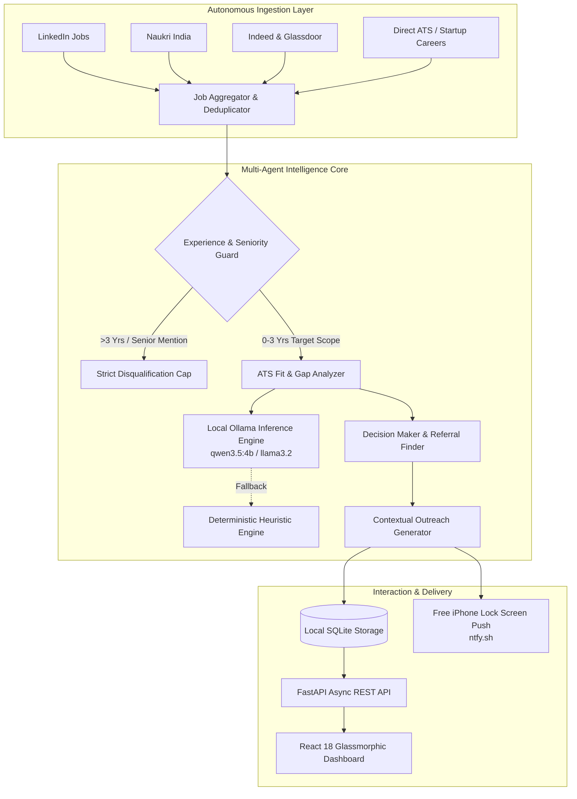

# 🚀 GetMeHired — Autonomous AI Job Hunter & Referral Engine

<p align="center">
  
  
  
  
  
  
</p>

> **An open-source, local-first developer tool that autonomously hunts high-fit job opportunities, filters out deceptive seniority requirements, discovers high-impact referral targets, and crafts tailored outreach with $0 API overhead.**

---

## 💡 Why I Built This (Motivation & Engineering Problem)

Navigating technical job boards is notoriously broken:
1. **The "Entry Level" Paradox**: Postings labeled "Associate" or "Junior" regularly bury requirements for 4–7+ years of experience in the description body.
2. **Black-Hole ATS Systems**: Submitting generic resumes into high-volume portals yields single-digit response rates without keyword alignment and referral support.
3. **Mass-Spam Bots Ruin Reputation**: Automated auto-apply bots flood companies with low-effort submissions, burning candidate credibility with recruiters.
4. **Subscription Paywalls & API Costs**: Existing career tools lock basic scrapers behind monthly subscriptions and charge expensive cloud LLM token fees.

**GetMeHired** was engineered as an independent side project to solve this end-to-end. It runs locally as a 24/7 autonomous career co-pilot that pairs high-precision scraping with local small language models (Ollama `qwen3.5:4b`), providing enterprise-grade candidate matching and referral discovery at **$0 budget**.

---

## 🏗️ System Architecture



> 📖 **Deep-Dive Technical Specification**: For the complete system design, micro-agent prompt isolation patterns, and database schema, read [**ARCHITECTURE.md**](architecture.md).

---

## 🤖 1-Click AI Setup: Personalize in 60 Seconds

You can configure the agent for **your exact background** without manually editing config files. Use any AI (ChatGPT, Claude, Gemini, DeepSeek) to read your resume and generate your complete `data/settings.json`:

👉 [**Read the 1-Click AI Profile Setup Guide**](AI_PROFILE_SETUP_GUIDE.md) — Includes the ready-to-copy master prompt!

---

## 🌟 Key Engineering Capabilities

### 1. Autonomous Multi-Source Ingestion ($0 Paid APIs)
- Concurrently queries and normalizes live postings across **LinkedIn**, **Naukri**, **Indeed**, and **Glassdoor**.
- Deduplicates listings across boards using title normalization and URL canonicalization.

### 2. Strict Seniority & Experience Guard
- Real-world job listings often misclassify seniority. The built-in extraction engine performs multi-pass regex and semantic evaluation across both title and body text:
  - Automatically identifies hidden senior markers (`3-6 years`, `lead engineer`, `mentor other devs`).
  - Disqualifies and caps out-of-scope roles so they never pollute recommendations.

### 3. Local-First Small Language Model (SLM) Optimization
- Designed specifically for local SLMs (e.g. `qwen3.5:4b`, `llama3.2`) to deliver instant local inference with **zero cloud data leakage**.
- **Micro-Call Architecture**: Prompts are broken into 3 isolated micro-tasks (Fit Scoring, Tailored Bullets, ATS Gaps) to maximize reasoning precision from 4B parameter models.
- **Graceful Fallbacks**: If the local LLM is cold or busy, deterministic heuristic scoring instantly calculates keyword overlap and pre-computes achievement bullets with 0ms downtime.

### 4. High-Potential Referral & Decision-Maker Discovery
- For every matched opening, the agent pinpoints 4 distinct outreach personas:
  - **Hiring Manager / Tech Lead**: Direct authority to review code and schedule interviews.
  - **Senior Engineer / Referral Champion**: Highest referral acceptance rate (motivated by internal bonuses).
  - **Technical Recruiter / Sourcer**: Job requisition owner.
  - **Leadership / Director**: Flagging for priority consideration.
- Generates 1-click **Boolean LinkedIn Search Queries** and **Google X-Ray Dorks** targeting real individuals at the target firm.

### 5. Multi-Channel Tailored Outreach Synthesizer
- Synthesizes candidate skills, project background, and target job requirements into:
  - **LinkedIn Connection Note** (Strictly under 300 characters to fit connection invite limits).
  - **Internal Referral Blurb** (Pre-written blurb that employees can copy-paste straight into company portals).
  - **Founder / InMail Pitch** (Punchy 100-word value proposition).
  - **Cold Email** (High-open subject line + 3-paragraph value proposition).

### 6. Free Instant Push Notifications (ntfy.sh)
- Direct integration with open-source push notification service **ntfy.sh**.
- When an opportunity crosses the configured match threshold (e.g., 75%+), the candidate immediately receives a notification on their phone lock screen with zero account setup.

---

## 🛠️ Quick Start & Setup

### 1. Prerequisites
- **Python 3.10+** (Tested on Python 3.11)
- **Local Ollama** (Optional: install [Ollama](https://ollama.ai) and run `ollama run qwen3.5:4b`. If Ollama is offline, built-in deterministic heuristics execute seamlessly)
- **Node.js 18+** (Optional: only needed if building/modifying the React frontend)

### 2. Installation
```bash
git clone https://github.com/<your-username>/GetMeHired.git
cd GetMeHired

# Create and activate virtual environment
python -m venv .venv

# Windows:
.\.venv\Scripts\Activate.ps1
# macOS/Linux:
source .venv/bin/activate

# Install dependencies
pip install -r requirements.txt
```

### 3. Configure Your Environment (.env)
```bash
cp .env.example .env
```
Open `.env` to configure your candidate profile, target parameters, and dashboard banners:
```env
# Candidate Profile
USER_FULL_NAME="Your Name"
USER_HEADLINE="Agentic AI & GenAI Systems Engineer"
USER_SKILLS="Python,LangGraph,FastMCP,RAG,FastAPI,Docker,PyTorch"

# Search Scope & Stage Settings
STAGE_BANNER_TITLE="Stage Ready for {name} ({salary} {role})"
STAGE_BANNER_DESCRIPTION="Your profile, skills, and target criteria are pre-loaded."
TARGET_ROLES="Agentic AI Engineer,Generative AI Engineer,AI Systems Engineer"
TARGET_LOCATIONS="Gurugram,Pune,Bengaluru,Remote"
TARGET_SALARY_DISPLAY="₹7-10 LPA"

# iPhone Push Alerts
NTFY_TOPIC=my_custom_job_alerts
```

### 4. Launch the Dashboard
**On Windows:** Double-click `start_agent.bat` or run:
```powershell
.\start_agent.bat
```
**Or via command line:**
```bash
uvicorn backend.main:app --host 127.0.0.1 --port 8000 --reload
```
Open **`http://127.0.0.1:8000`** in your browser.

---

## 📂 Project Structure

```
GetMeHired/
├── .env.example                # Documented configuration template
├── .gitignore                  # Git privacy & security manifest
├── LICENSE                     # MIT Open Source License
├── README.md                   # Technical documentation
├── requirements.txt            # Python dependencies
├── start_agent.bat             # 1-Click launcher
│
├── backend/
│   ├── main.py                 # FastAPI application & REST endpoints
│   ├── config.py               # Dynamic .env & settings manager
│   ├── database.py             # SQLite data access & migration layer
│   ├── pipeline.py             # Autonomous multi-agent runner & scheduler
│   ├── scheduler.py            # APScheduler autonomous loop
│   ├── ollama_client.py        # Local Ollama client with timeout fallbacks
│   ├── scrapers/
│   │   ├── aggregator.py       # Deduplication & multi-source engine
│   │   ├── jobspy_scraper.py   # LinkedIn, Indeed, Glassdoor scraper
│   │   ├── naukri_scraper.py   # Naukri India crawler
│   │   ├── wellfound_scraper.py# Startup & tech crawler
│   │   └── deep_jd_fetcher.py  # Full JD content extractor
│   ├── agents/
│   │   ├── job_matcher.py      # ATS fit scoring & experience disqualifier
│   │   ├── contact_finder.py   # Referral & decision-maker search generator
│   │   └── outreach_generator.py# 1-Click Cold DM & Referral copywriter
│   └── notifications/
│       └── notifier.py         # ntfy.sh lock-screen push dispatcher
│
├── frontend/
│   ├── src/
│   │   ├── App.jsx             # React dashboard & candidate deep-dive drawer
│   │   ├── index.css           # Glassmorphic dark-mode design system
│   │   └── main.jsx            # React root
│   ├── dist/                   # Production bundle served directly by FastAPI
│   └── vite.config.js          # Vite build config
│
└── data/
    ├── .gitkeep
    └── settings.example.json   # Sample settings configuration
```

---

## 📄 License

This project is licensed under the [MIT License](LICENSE) — free for personal and commercial use.
