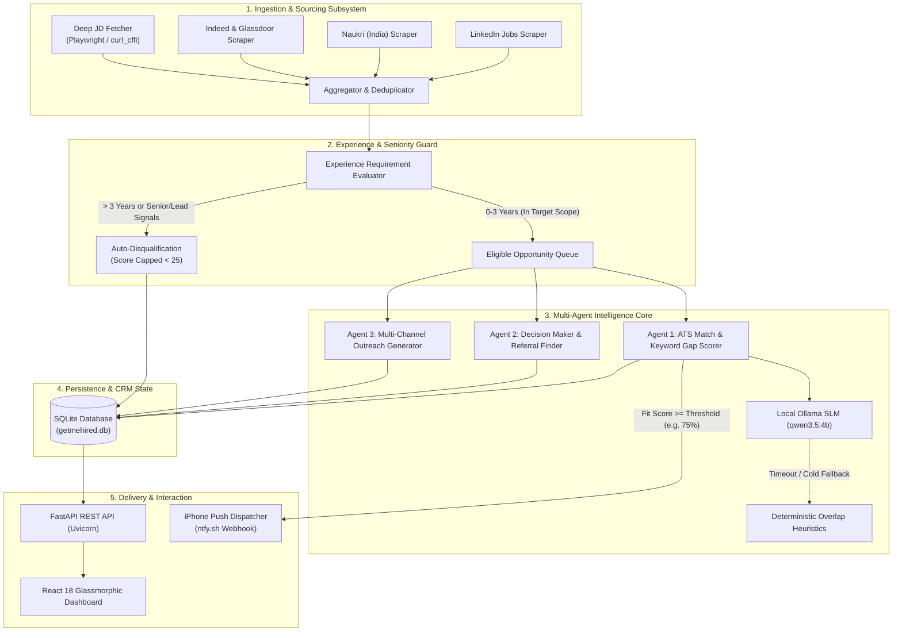
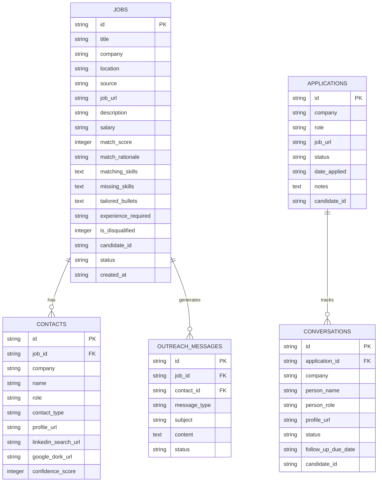

# 🏛️ GetMeHired — System Architecture & Engineering Design

This document provides a comprehensive technical overview of the architecture, design principles, data flow, and multi-agent coordination powering **GetMeHired**.

---

## 📐 1. System Architecture Overview

GetMeHired is designed as a **local-first, autonomous multi-agent co-pilot**. It decouples background ingestion and scraping from inference, persistence, and UI presentation.



---

## 🧩 2. Core Architectural Principles

### 2.1 Local-First & Zero Cloud Leakage
- **$0 API Bills**: All reasoning, scoring, and text generation execute locally via [Ollama](https://ollama.ai) (`qwen3.5:4b`, `llama3.2`, etc.).
- **Data Privacy**: Resumes, contact records, application history, and notes never leave the user's local machine.
- **Offline Resilience**: Built-in deterministic heuristic engines ensure that even if the local LLM is offline or busy, the search and matching pipelines continue running.

### 2.2 Micro-Call LLM Design (SLM Optimization)
Small language models (3B–7B parameters) frequently degrade, hallucinate, or drop JSON formatting when overloaded with monolithic prompts. 

GetMeHired solves this through **isolated micro-prompts**:
1. **Call 1 (Scoring)**: Evaluates quantitative alignment (0–100) and rationale.
2. **Call 2 (Tailored Bullets)**: Generates resume bullets customized to the company's tech stack.
3. **Call 3 (ATS Keyword Gaps)**: Compares required keywords against the candidate's skills.

If any micro-call fails or times out, the system seamlessly falls back to pre-computed deterministic text generation without failing the pipeline.

### 2.3 Strict Seniority & Experience Guard
Job boards frequently mislabel positions (e.g., categorizing an "Associate" role that secretly requires 5+ years of experience). 

The `extract_experience_requirement()` engine runs multi-pass regex across job titles and full JD descriptions:
- **Senior Role Patterns**: Detects `senior`, `lead`, `principal`, `staff`, `architect`, `mentoring other engineers`, etc.
- **Experience Ranges**: Extracts unicode numeric ranges (`3-6 years`, `4+ years`, `5–8 yrs`).
- **Disqualification Logic**: Automatically marks out-of-scope roles as `is_disqualified = True`, penalizing fit scores by 60–70 points so they never trigger push notifications.

---

## 🔄 3. Multi-Agent Pipeline Workflow

```
[Trigger: APScheduler (every 30 mins) or 1-Click UI]
    │
    ▼
1. Sourcing Phase (aggregator.py)
   ├── Query LinkedIn, Naukri, Indeed, Glassdoor with target roles & locations
   ├── Normalize job titles, companies, and locations
   └── Hash-based deduplication (company + title + URL)
    │
    ▼
2. Filtering Phase (deep_jd_fetcher.py & job_matcher.py)
   ├── Fetch full job description if truncated (Playwright / HTTP fallback)
   ├── Run Seniority & Experience Guard
   └── Queue eligible jobs for evaluation
    │
    ▼
3. Multi-Profile Round-Robin LLM Enrichment (pipeline.py)
   ├── Iterates through configured candidate profiles
   ├── Enforces 45-minute autonomous window guard
   ├── Executes micro-agents (Job Matcher, Contact Finder, Outreach Generator)
   └── Commits enriched opportunities to SQLite
    │
    ▼
4. Alert & Delivery Phase (notifier.py)
   ├── Checks if match_score >= auto_notify_threshold (default: 75%)
   └── Dispatches immediate push notification to candidate's mobile device via ntfy.sh
```

---

## 🗄️ 4. Database Schema & Persistence

GetMeHired uses a relational SQLite database (`data/getmehired.db`) managed via `backend/database.py`:



---

## ⚙️ 5. Configuration & State Management

GetMeHired enforces a zero-inline-code policy. State and configuration are read through a 3-tier hierarchy:

1. **Environment Variables (`.env`)**: Highest precedence. Used for server, scheduler, and default profile settings.
2. **Persisted Settings (`data/settings.json`)**: User-editable runtime state modified via the React dashboard settings tab.
3. **Code Defaults (`backend/config.py`)**: Safe fallback values if no configuration exists.

All candidate profile definitions, stage banners, blacklisted companies, and notification targets are stored in `data/settings.json`, ensuring the codebase remains 100% agnostic to any specific candidate.

---

## 🛡️ 6. Error Handling & Reliability

- **Ollama Offline**: If Ollama is not running, `ollama_client.py` gracefully fails health checks, triggering deterministic keyword overlap calculations and standard achievement bullet generation.
- **Scraper Rate Limiting**: Scrapers incorporate random jitter delays, exponential backoffs, and user-agent rotation to prevent IP bans.
- **Process Protection**: The autonomous loop runs inside a 45-minute strict timeout cap (`max_duration_seconds = 45 * 60`), preventing hung child threads from consuming system resources.
- **Git Shielding**: Sensitive files (`.env`, `*.db`, personal resumes `*.pdf`) are strictly excluded in `.gitignore` to prevent credential and personal data exposure.
